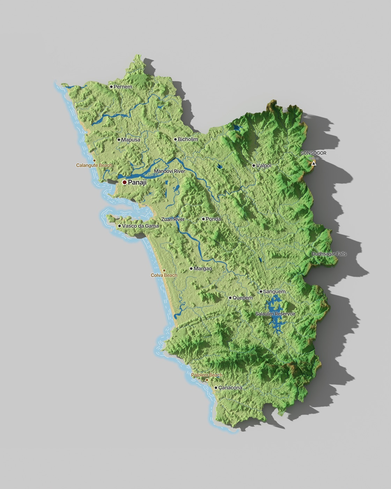
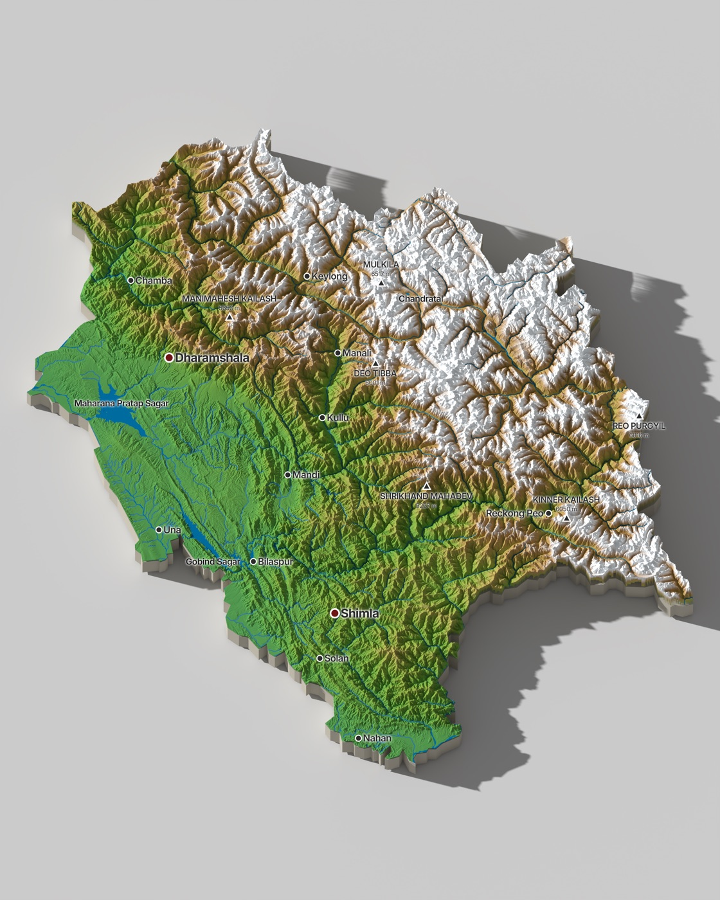
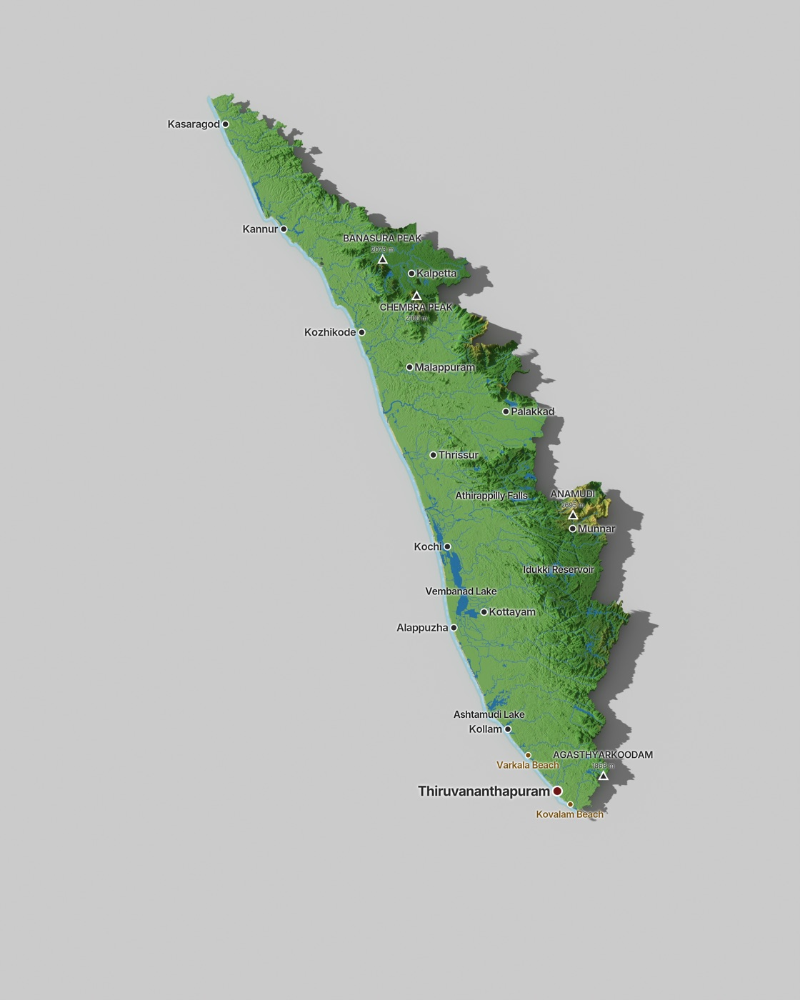

# Relief Maps

Turn any Indian state into a 3D shaded-relief map: tilted terrain, soft shadows, rivers and labelled cities and peaks, ready to post as a vertical story or slide. The maps are made in R with rayshader, and a Blender path gives a higher-quality 3D hero render.

| Goa | Himachal Pradesh | Kerala |
|---|---|---|
|  |  |  |

## What you get

- A 1080 by 1920 vertical image with a studio-grey backdrop and a baked-in drop shadow.
- Colours that follow the height of the land: teal lowlands, then tan, brown ridges and cream peaks.
- Rivers, cities, capitals and marquee peaks, with labels you control through simple CSV files.
- A recipe for each state you can re-run: 13 states and Mumbai are already set up in `blender/` and the CSV folders.

## Quick start

1. Run `./setup.sh` once. It installs R, the map libraries (GDAL, GEOS, PROJ) and the R packages.
2. Add your cities in `cities/<state>.csv`, or reuse one that exists.
3. Render a state: `Rscript render_state.R "Uttarakhand" 9 40 256 90`

The image lands in `output/`. A full render takes 8 to 10 minutes. The preview settings below give a rough look in about one minute.

## Data and credits

- Terrain: Copernicus DEM through the AWS Terrain Tiles service (via the `elevatr` package).
- Rivers and lakes: OpenStreetMap contributors, available under the ODbL licence. Keep that credit if you publish a map.
- Labels use the Inter font, which is open source (SIL Open Font Licence).
- State outlines: not included. Bring your own boundary file (see Boundaries below). Check its licence and how it draws India's border before you publish a map.
- Code: MIT licence, see `LICENSE`.

Made by [TheMapsDaily](https://themapsdaily.com). Everything below is the technical detail.

## Anatomy of the render

| Layer | Shows | Source |
|-------|-------|--------|
| Terrain slab + hillshade | mountains vs plains | Copernicus/AWS Terrain DEM via `elevatr` (no API key) |
| Hypsometric tint | elevation bands | the DEM itself |
| Ambient occlusion | valley/ridge depth | rayshader `ambient_shade` |
| Rivers | drainage | OpenStreetMap waterways via `osmdata` |
| Grey backdrop + drop shadow | studio look | `render_highquality` path tracer (grey ground plane) |

## Setup (one time)

```bash
./setup.sh          # installs R, GDAL/GEOS/PROJ, and the R packages
```

## Add a new state

1. Create `cities/<slug>.csv` with columns `name,lat,long,capital` (capital=1 for
   the capital, 0 otherwise). Pick the prominent cities — curated beats OSM clutter.
2. Render:

```bash
Rscript render_state.R "Uttarakhand" 9 40 256 90
#                        state       |  |   |  |
#                        zoom (DEM res)  |  |  phi (camera tilt; 90=top-down, mappdout look)
#                        zscale ---------+  samples (path-trace quality, <=256)
#                        (HIGHER zscale = flatter/more natural; LOWER = spiky)
```

Output → `output/<slug>.png`, a **1080×1920 vertical** studio canvas (grey backdrop +
soft drop shadow baked in by the path tracer — drop it straight onto a story/slide).

## Fast iteration (env toggles)

Full render is ~8–10 min. For quick look/exposure/label checks (~1 min) render a
half-res 9:16 canvas with AO off:

```bash
RELIEF_AO=0 RELIEF_OUT_W=540 RELIEF_OUT_H=960 Rscript render_state.R "Uttarakhand" 9 40 40 90
```

| env | default | effect |
|-----|---------|--------|
| `RELIEF_AO` | 1 | ambient occlusion (slow) — turn off for previews |
| `RELIEF_OUT_W` / `RELIEF_OUT_H` | 1080 / 1920 | canvas px (keep 9:16 so labels project right) |
| `RELIEF_GROUND` | `#e0ddd7` | studio backdrop albedo (bright warm grey) |
| `RELIEF_VIGNETTE` | 0 | radial backdrop vignette (off — dirties the corners) |
| `RELIEF_POP` | 1 | post saturation/brightness pop (matches reference vividness) |
| `RELIEF_RIVERS` | 1 | OSM river overlay (cached after first fetch) |
| `RELIEF_LABELS` | 1 | city/capital labels |
| `RELIEF_LABELSIZE` | 24 | label font size |
| `RELIEF_ZOOM` | 1.0 | camera distance — HIGHER = more margin (never crop) |

> Background is baked by the render (`shadow=TRUE` gives the base plane that
> `ground_material` tints and the key light drops the shadow onto). Keep the
> `RELIEF_OUT_*` aspect at 9:16 — the label projection assumes it. Interior DEM
> NoData holes are auto-filled so they don't show as black voids under top-down.

## Tuning knobs (in render_state.R)

- **`zscale`** — vertical exaggeration. Plains states need a *lower* number to read;
  tall Himalayan states can go higher (40 = natural for Uttarakhand).
- **palette `pal`** — the teal→sage→tan→brown→cream ramp (mappdout look). Teal is
  reserved for the lowest ~15%; deeper `ray_shade(sunaltitude=45)` gives crisp canyons.
- Labels are drawn in POST (projected + `ragg`/Inter + `magick` composite) — NOT
  via `render_label` (its text renders mirrored in `render_highquality`).
- Rivers composited manually (rayshader 0.37/rayimage 0.26 `add_overlay` is broken).

## Boundaries

This repository does not ship boundary files. The scripts read a GeoJSON of states or union territories with the state name in a column called `st_nm`, from `data/boundaries/india-2021.geojson` by default. Put your file there, or point to it for one run:

Override per run without editing any script:

```bash
RELIEF_BOUNDARY=/path/to/india-1956.geojson Rscript render_state.R "Madhya Pradesh" 9 40 256 90
```

`BOUNDARY_GPKG` still overrides at a higher priority in `blender/export_dem.R`
for the high-detail single-state OSM polygons (Goa's coastline needs it).

## Repo layout

| Path | Holds |
|------|-------|
| `render_state.R` | rayshader path — 2D top-down composite, ~8–10 min |
| `blender/` | Blender/Cycles path — the 3D hero render (see `blender/README.md`) |
| `blender/<state>/` | one-off per-state fetch/build scripts kept as a record of how that state's water, boundary and peaks were produced — see caveat below |
| `data/boundaries/` | empty on purpose: put your own boundary file here |
| `cities/<slug>.csv` | curated city labels (`name,lat,long,capital`) |
| `peaks/<slug>.csv` | marquee peaks (`name,lat,long,elev_m`) — DEM-verified |
| `features/<slug>.csv` | area labels (ranges, plateaus, valleys) |
| `palettes/<slug>.txt` | per-state hypsometric ramp — **bare hex lines, one per row** |
| `fonts/` | Inter 400/600/700 for label compositing |
| `output/<slug>/` | all render products — git-ignored, archived to R2 |

> **Running the scripts in `blender/<state>/`:** each one finds the repository through the `RELIEF_MAPS_ROOT` environment variable and falls back to the folder you run it from. Set it once, for example `export RELIEF_MAPS_ROOT=$(pwd)`, and they work from any machine.

## Output hygiene

`output/` is generated and git-ignored — DEM tiles, intermediates and the hero
PNGs, ~2.6 GB. Only scripts and the per-state curation CSVs are tracked. The
archive lives in Cloudflare R2 under `relief-maps/`.
